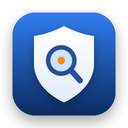
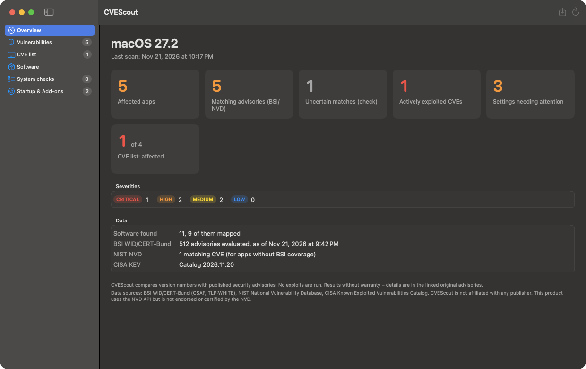

<p align="center"></p>

# CVEScout

🇬🇧 [English version](README.md) · [](#wie-cvescout-entstanden-ist)

**Lokaler Schwachstellen-Check für macOS auf Basis der Sicherheitshinweise des BSI – ergänzt um die NVD.**

CVEScout erfasst die auf deinem Mac installierte Software, gleicht deren Versionen mit den
öffentlichen Sicherheitshinweisen des BSI (WID / CERT-Bund) ab und prüft wichtige
Sicherheitseinstellungen von macOS. Aktiv ausgenutzte Lücken werden über den
CISA-Katalog *Known Exploited Vulnerabilities* (KEV) hervorgehoben.

Auf Deutsch und Englisch – folgt der Systemsprache, umschaltbar in den Einstellungen bzw. mit `--lang`.

<p align="center"><br><sub>Screenshot mit Demo-Daten (<code>CVESCOUT_DEMO=1</code>)</sub></p>

## Was CVEScout macht – und was nicht

- ✅ **Passiv und lokal:** Es werden nur Versionsnummern (Info.plist, Homebrew) und Systemeinstellungen gelesen.
- ✅ **Keine Inhalte über dein System verlassen den Mac.** Heruntergeladen werden öffentliche Feeds (BSI-CSAF, CISA-KEV).
  Für die NVD-Abfrage werden Produktname und Version einzelner Programme (z. B. `electrum 4.0.9`) bzw. CVE-IDs
  an die NVD-API gesendet – abschaltbar in den Einstellungen bzw. mit `--no-nvd`.
- ✅ **Keine Admin-Rechte nötig**, nichts wird verändert.
- ❌ **Es werden keine Exploits ausgeführt.** Ein „echter“ Angriffstest wäre riskant, unzuverlässig und für die
  meisten CVEs ohnehin nicht ohne Schaden möglich. Der Versionsabgleich ist das Verfahren, das auch
  professionelle Scanner für lokale Prüfungen verwenden.

## Funktionen

| Bereich | Details |
|---|---|
| Software-Inventar | macOS-Version, Programme in `/Applications` und `~/Applications`, Homebrew-Formeln |
| BSI-Abgleich | CSAF-2.0-Dokumente des BSI-WID-Portals (TLP:WHITE), Versionsbereiche je Release-Linie (z. B. *Tahoe <26.7.2*) |
| NVD als zweite Quelle | Programme ohne BSI-Abdeckung (Discord, Telegram, Signal, 1Password, Brave, iTerm2, Little Snitch, Ledger Live, Electrum, …) über kuratierte CPE-Namen; Hinweise nur für Windows/Android/iOS werden verworfen |
| Aktiv ausgenutzt | Markierung über CISA KEV, Schweregrad wird dann auf „kritisch“ angehoben |
| **CVE-Liste** | TXT-Datei mit einer CVE pro Zeile prüfen → *Betroffen / Nicht betroffen / Produkt nicht installiert / Keine Daten*; CVEs ohne BSI-Hinweis werden in der NVD nachgeschlagen (inkl. CVSS) |
| Systemprüfungen | SIP, Gatekeeper, FileVault, Firewall + Tarnmodus, offene Fernzugriffsdienste, **ausstehende Apple-Updates**, automatische Updates, XProtect-Aktualität, automatische Anmeldung, Gastbenutzer |
| Autostart-Objekte | Launch-Agents und -Daemons mit Signaturprüfung (Apple / Developer ID / nicht signiert / ad-hoc), Skripte über Interpreter, verwaiste Einträge, ungewöhnliche Orte |
| Browser-Erweiterungen | Chrome, Brave, Edge, Vivaldi, Arc, Chromium, Firefox und Safari – markiert Erweiterungen mit Zugriff auf alle Webseiten und weitreichenden Rechten |
| Menüleiste & Hintergrund | Status-Symbol in der Menüleiste, automatischer Scan (6 h bis wöchentlich), Mitteilungen nur bei neuen Funden, Autostart beim Anmelden, Dock-Symbol optional |
| Export | Bericht als Markdown oder JSON |
| CLI | `cvescout` für Terminal, Skripte und Automatisierung (Exit-Code 2 bei Funden) |

## Installation

**Fertige App:** `CVEScout-<version>.dmg` von der [Releases-Seite](https://github.com/seyi23/CVEScout/releases)
laden und CVEScout in *Programme* ziehen. Die App ist noch nicht von Apple notarisiert – beim ersten Start unter
**Systemeinstellungen › Datenschutz & Sicherheit › „Trotzdem öffnen“** freigeben.

**Selbst bauen** (macOS 14+, Xcode 26+ / Swift 6.2+):

```bash
./scripts/build-app.sh          # baut build/CVEScout.app (ad-hoc signiert)
open build/CVEScout.app
```

Kommandozeile:

```bash
swift run cvescout                              # vollständiger Scan
swift run cvescout --cves examples/cve-liste-beispiel.txt
swift run cvescout --markdown > bericht.md
swift run cvescout --help
NVD_API_KEY=… swift run cvescout              # schnellere NVD-Abfragen mit eigenem Schlüssel
```

**NVD-Rate-Limit:** Ohne API-Schlüssel erlaubt die NVD 5 Abfragen pro 30 Sekunden. Der erste Scan dauert
dann etwa eine Minute, danach sind die Antworten 24 h zwischengespeichert. Einen kostenlosen Schlüssel gibt es
unter [nvd.nist.gov/developers](https://nvd.nist.gov/developers/request-an-api-key); in der App wird er im
Schlüsselbund gespeichert.

### CVE-Liste prüfen

Eine Textdatei mit einer CVE-ID pro Zeile (Groß-/Kleinschreibung egal, `#` = Kommentar, Text hinter der ID
wird ignoriert). In der App über **Ablage › CVE-Liste importieren … (⌘I)**, den Toolbar-Button oder per
Drag & Drop ins Fenster; im Terminal mit `--cves DATEI`. CVEs aus der Liste werden unabhängig vom
eingestellten Zeitraum geprüft.

## Wie der Abgleich funktioniert

1. Der ROLIE-Feed des BSI (`bsi-wid-white.json`, ~15.000 Hinweise) wird geladen und nach Hersteller,
   Produkt und CVE indiziert (Cache 6 h).
2. Installierte Software wird BSI-Produkten zugeordnet, gesichert über einen kuratierten Katalog
   ([`ProductCatalog.swift`](Sources/CVEScoutCore/ProductCatalog.swift)) oder heuristisch
   (App-Name = BSI-Produkt und Hersteller steckt im Bundle-Identifier).
3. Für passende Hinweise wird das CSAF-Dokument geladen (dauerhaft gecacht je Revision) und der
   Produktbaum ausgewertet: Liegt die installierte Version in einem als *known_affected* markierten Bereich
   und nicht über der Fix-Version ihrer eigenen Release-Linie, gilt sie als betroffen.
4. Hinweise nur für iOS/Android sowie Versionsangaben anderer Plattformen werden ignoriert.
5. Programme ohne BSI-Zuordnung, aber mit bekanntem CPE-Namen, werden bei der NVD per `cpeName` abgefragt.
   Treffer werden lokal nachgeprüft: Konfigurationen, die nur zusammen mit einem anderen Betriebssystem gelten,
   und Einträge ohne jede Versionsgrenze werden verworfen.
6. **Plausibilitätsprüfung:** Liegt die installierte Version weit unter allen Versionen, die ein Hinweis nennt
   (z. B. Obsidian 1.15 gegen „<6.3.1“ von *Obsidian Scheduler*), oder nennt der Hinweis keine Fix-Version, wird der
   Treffer als *unsicher* markiert und getrennt angezeigt. Bekannte Fehlzuordnungen des BSI stehen in
   `ProductCatalog.misattributedAdvisories`.
7. Homebrew-Pakete ohne kuratierten Eintrag werden automatisch zugeordnet, wenn das BSI ein gleichnamiges
   „Open Source“-Produkt führt (z. B. `libpng`, `freetype`, `rclone`).

## Projektstruktur

```
Sources/CVEScoutCore   Inventar, Systemprüfungen, BSI/CSAF, KEV, Versionslogik, Scanner, Export
Sources/CVEScoutApp    SwiftUI-Oberfläche
Sources/CVEScoutCLI    Kommandozeilenwerkzeug „cvescout“
Tests/                 Unit-Tests (Swift Testing): swift test
scripts/               build-app.sh (App-Bundle), package-release.sh (zip/dmg), make-icon.swift (Icon)
.github/workflows/     CI (Build + Tests) und Release (bei Tag v*)
```

Release erstellen: CHANGELOG ergänzen, dann `git tag v0.4.0 && git push origin v0.4.0` – GitHub Actions baut,
testet und veröffentlicht zip, dmg und CLI.

## Ideen nach 1.0

- Weitere Katalog-Einträge (Beiträge willkommen, siehe CONTRIBUTING.md)
- Signierte und notarisierte Releases (Workflow ist vorbereitet, benötigt ein Developer-ID-Zertifikat)
- Anmeldeobjekte über `SMAppService` (nur mit erweiterten Rechten lesbar)

## Wie CVEScout entstanden ist

CVEScout ist ein **Vibe-Coding**-Projekt: Es ist im Dialog mit [Claude Code](https://claude.com/claude-code)
entstanden, dem KI-Programmierassistenten von Anthropic. Idee, Anforderungen und Entscheidungen (Umfang,
Datenquellen, was veröffentlicht wird) kamen von mir; Claude hat Code, Tests und Dokumentation geschrieben und die
Ergebnisse mit echten Scans auf meinem Mac überprüft – inklusive Korrekturen von Fehlalarmen, etwa eines
BSI-Hinweises, der dem falschen Produkt zugeordnet war.

Da es ein Sicherheits-Tool ist: Die Abgleichslogik ist durch Unit-Tests abgedeckt und jeder Treffer verlinkt auf den
Originalhinweis, trotzdem können Ergebnisse falsch sein. Fehler- und Fehlalarm-Meldungen sind sehr willkommen.

## Lizenz

[MIT](LICENSE). Hinweise zu den Datenquellen und zum Datenschutz stehen in [NOTICE.md](NOTICE.md).

*This product uses the NVD API but is not endorsed or certified by the NVD.*

## Haftungsausschluss

Die Ergebnisse beruhen auf Versionsvergleichen mit öffentlich verfügbaren Daten und können unvollständig
oder fehlerhaft sein. Maßgeblich sind die verlinkten Originalhinweise des BSI und der Hersteller.
CVEScout ist kein Produkt des BSI.

Datenquellen: [BSI WID / CERT-Bund (CSAF)](https://wid.cert-bund.de/.well-known/csaf/provider-metadata.json) ·
[NIST NVD](https://nvd.nist.gov) · [CISA Known Exploited Vulnerabilities](https://www.cisa.gov/known-exploited-vulnerabilities-catalog)

Mitmachen: siehe [CONTRIBUTING.md](CONTRIBUTING.md) · Sicherheitslücken in CVEScout bitte vertraulich melden: [SECURITY.md](SECURITY.md)
