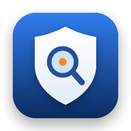
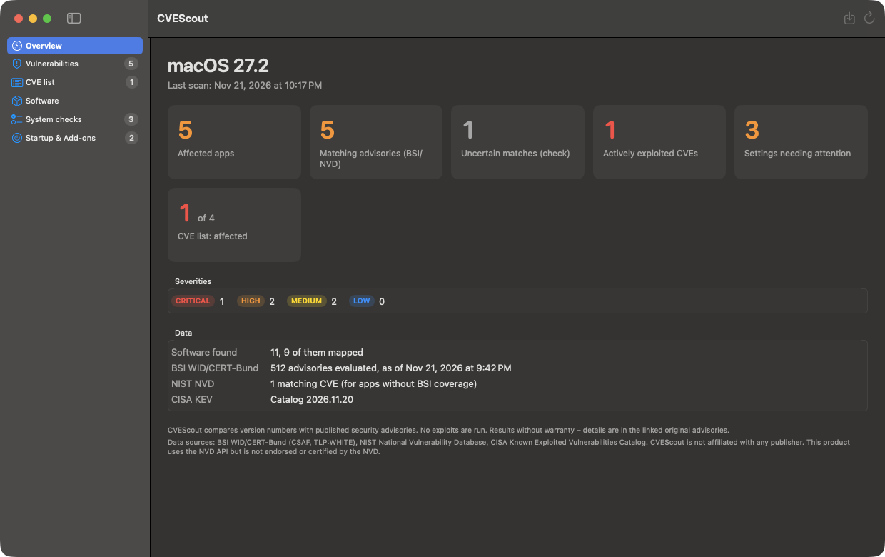
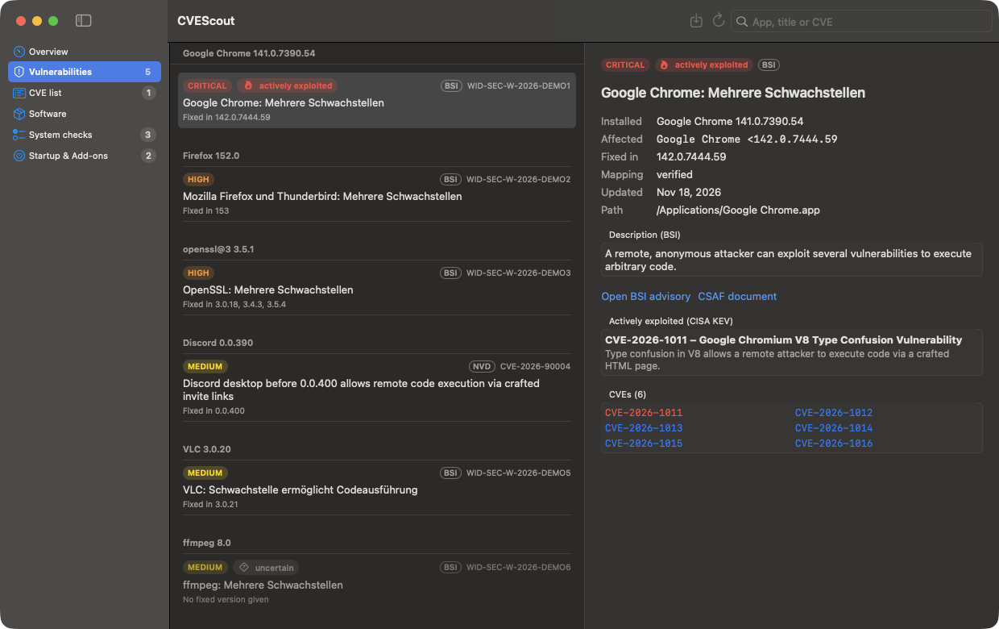
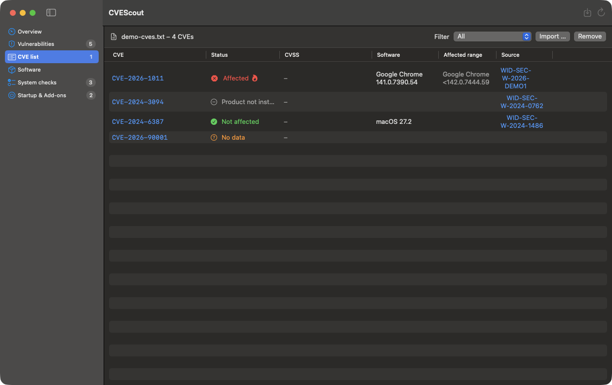
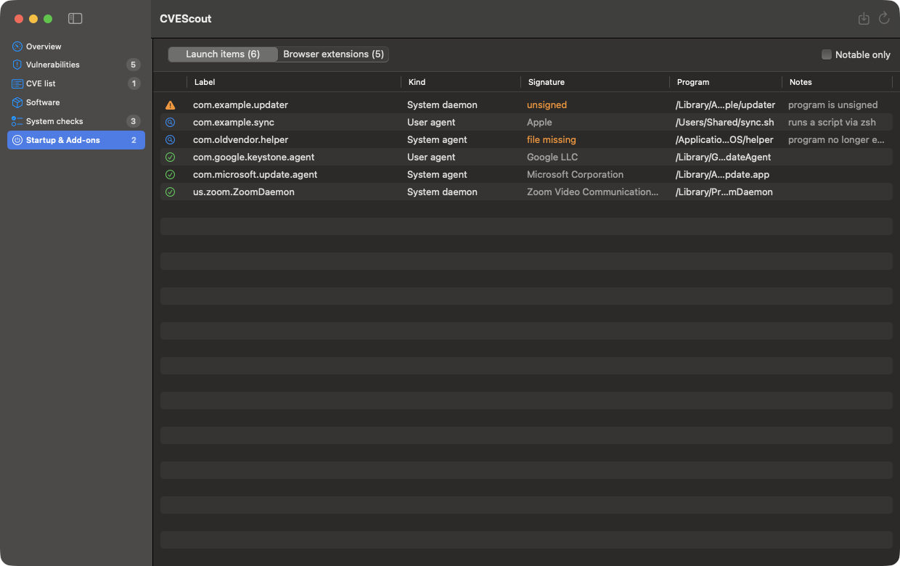

<p align="center"></p>

# CVEScout

[](https://github.com/seyi23/CVEScout/actions/workflows/ci.yml)
[](LICENSE)

[](#how-this-was-built)

🇩🇪 [Deutsche Version](README.de.md)

**A local vulnerability check for your Mac, based on the security advisories of Germany's Federal Office for
Information Security (BSI) and the U.S. National Vulnerability Database (NVD).**

CVEScout inventories the software installed on your Mac, matches the versions against published security
advisories and checks the most important macOS security settings. Vulnerabilities that are actively exploited
in the wild are highlighted using the CISA *Known Exploited Vulnerabilities* catalog.

Available in English and German (follows the system language, switchable in the settings or with `--lang`).

<p align="center">
  
  
  
  
</p>
<p align="center"><sub>Screenshots show fictitious demo data (<code>CVESCOUT_DEMO=1</code>).</sub></p>

## What CVEScout does – and what it doesn't

- ✅ **Passive and local.** It only reads version numbers (Info.plist, Homebrew) and system settings.
- ✅ **Your data stays on your Mac.** Public feeds (BSI CSAF, CISA KEV) are downloaded. For the NVD lookup,
  only CPE product names with versions (e.g. `electrum 4.0.9`) and CVE ids are sent – can be turned off.
- ✅ **No admin rights required**, nothing is changed.
- ❌ **No exploits are run.** Real attack tests would be risky, unreliable and impossible without side effects
  for most CVEs. Version matching is what professional scanners use for local (authenticated) checks too.

## Features

| Area | Details |
|---|---|
| Software inventory | macOS version, apps in `/Applications` and `~/Applications`, Homebrew formulae |
| BSI matching | CSAF 2.0 advisories from BSI WID/CERT-Bund (TLP:WHITE), version ranges per release line (e.g. *Tahoe <26.7.2*) |
| NVD as second source | Apps the BSI does not cover (Discord, Telegram, Signal, 1Password, Brave, iTerm2, Little Snitch, Ledger Live, Electrum, …) via curated CPE names; Windows/Android/iOS-only entries are discarded |
| Actively exploited | Flagged via CISA KEV, severity raised to critical |
| **CVE list** | Check a TXT file with one CVE per line → *affected / not affected / product not installed / no data*, with CVSS from the NVD |
| System checks | SIP, Gatekeeper, FileVault, firewall + stealth mode, exposed remote services, pending Apple updates, automatic updates, XProtect freshness, automatic login, guest account |
| Startup items | Launch agents and daemons with code-signature check (Apple / Developer ID / unsigned / ad-hoc), scripts run through interpreters, orphaned entries, unusual locations |
| Browser extensions | Chrome, Brave, Edge, Vivaldi, Arc, Chromium, Firefox and Safari – flags extensions with access to all websites plus powerful permissions |
| Plausibility check | Matches that are formally correct but implausible (e.g. same product name, different product) are marked *uncertain* instead of raising an alarm |
| Menu bar & background | Status icon in the menu bar, automatic scans (6 h to weekly), notifications only for *new* findings, new startup items or new extensions, launch at login |
| Export & CLI | Markdown/JSON reports, `cvescout` command line tool (exit code 2 on findings) |
| Languages | English and German – app, CLI and reports. Advisory titles from the BSI are published in German only. |

## Installation

**Download:** get `CVEScout-<version>.dmg` from the [releases page](https://github.com/seyi23/CVEScout/releases)
and drag CVEScout to *Applications*. The app is not notarized by Apple yet – on first launch, allow it under
**System Settings › Privacy & Security › “Open Anyway”**.

**Build from source** (macOS 14+, Xcode 26+ / Swift 6.2+):

```bash
./scripts/build-app.sh          # builds build/CVEScout.app (ad-hoc signed)
open build/CVEScout.app
```

Command line:

```bash
swift run cvescout                                    # full scan
swift run cvescout --cves examples/cve-liste-beispiel.txt
swift run cvescout --markdown > report.md
NVD_API_KEY=… swift run cvescout                      # faster NVD lookups with your own key
swift run cvescout --lang en                          # force English output (or CVESCOUT_LANG=en)
```

Without an API key the NVD allows 5 requests per 30 seconds, so the first scan takes about a minute; results
are cached for 24 hours. A free key is available at
[nvd.nist.gov/developers](https://nvd.nist.gov/developers/request-an-api-key) (stored in the Keychain by the app).

## How matching works

1. The BSI ROLIE feed (~15,000 advisories) is indexed by vendor, product and CVE (cached for 6 h).
2. Installed software is mapped to BSI products through a curated catalog
   ([`ProductCatalog.swift`](Sources/CVEScoutCore/ProductCatalog.swift)) or a heuristic
   (app name = BSI product and vendor contained in the bundle identifier).
3. For matching advisories the CSAF document is evaluated: a version is affected if it lies in a
   *known_affected* range and below the fixed version of its own release line.
4. Apps without BSI coverage but with a known CPE name are looked up in the NVD; configurations that only
   apply together with another operating system and entries without any version bound are discarded.
5. Startup items: launchd plists are read and the started program's code signature is verified with the
   Security framework. Scripts started through `sh`, `osascript`, `python` … are marked for review.
6. Implausible matches (installed version far below every version an advisory names, or no fixed version at
   all) are marked *uncertain* and not counted. Known misattributed advisories are skipped.

## Project layout

```
Sources/CVEScoutCore   inventory, checks, BSI/CSAF, NVD, KEV, version logic, scanner, export
Sources/CVEScoutApp    SwiftUI app (window + menu bar)
Sources/CVEScoutCLI    command line tool "cvescout"
Tests/                 unit tests (Swift Testing, offline): swift test
scripts/               build-app.sh, package-release.sh, make-icon.swift, screenshots.sh
.github/workflows/     CI (build + tests) and release (on tag v*)
```

## Ideas after 1.0

- More catalog entries (contributions welcome – see below)
- Signed and notarized releases (the release workflow is ready; it needs a Developer ID certificate)
- Login items registered via `SMAppService` (needs privileges to read)

## How this was built

CVEScout is a **vibe coding** project: it was built in conversation with [Claude Code](https://claude.com/claude-code),
Anthropic's AI coding assistant. The idea, the requirements and the decisions (scope, data sources, what to
publish) came from me; Claude wrote the code, the tests and the documentation, and checked the results against
real scans on my Mac – including fixing false positives such as an advisory filed under the wrong product.

Because this is a security tool, please treat it accordingly: the matching logic is covered by unit tests and every
finding links to its original advisory, but results can still be wrong. Bug reports and false-positive reports are
very welcome.

## Contributing

Catalog entries and false-positive reports are the most valuable contributions – see
[CONTRIBUTING.md](CONTRIBUTING.md). Please report vulnerabilities in CVEScout itself privately: [SECURITY.md](SECURITY.md).

## License and data sources

[MIT](LICENSE). Data sources, attribution and privacy details: [NOTICE.md](NOTICE.md).

*This product uses the NVD API but is not endorsed or certified by the NVD.*
CVEScout is not a product of the BSI and is not endorsed by CISA. Results are based on version comparisons
with public data and may be incomplete or wrong; the linked original advisories are authoritative.
